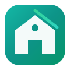
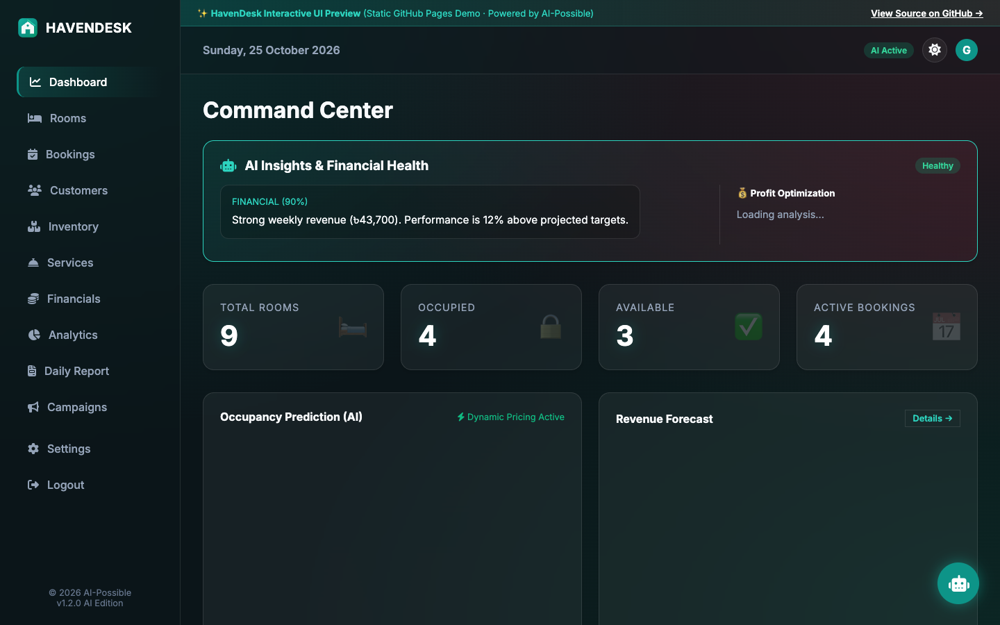
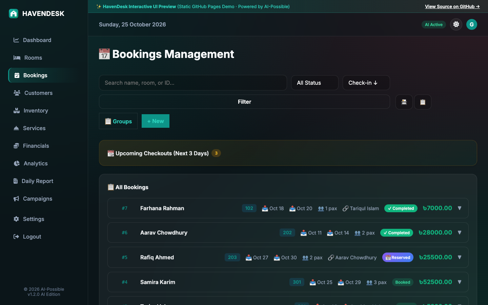
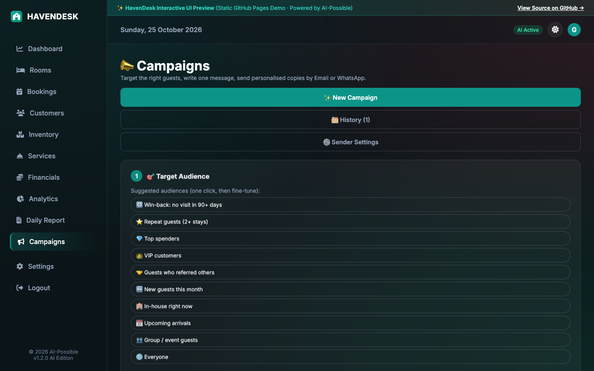
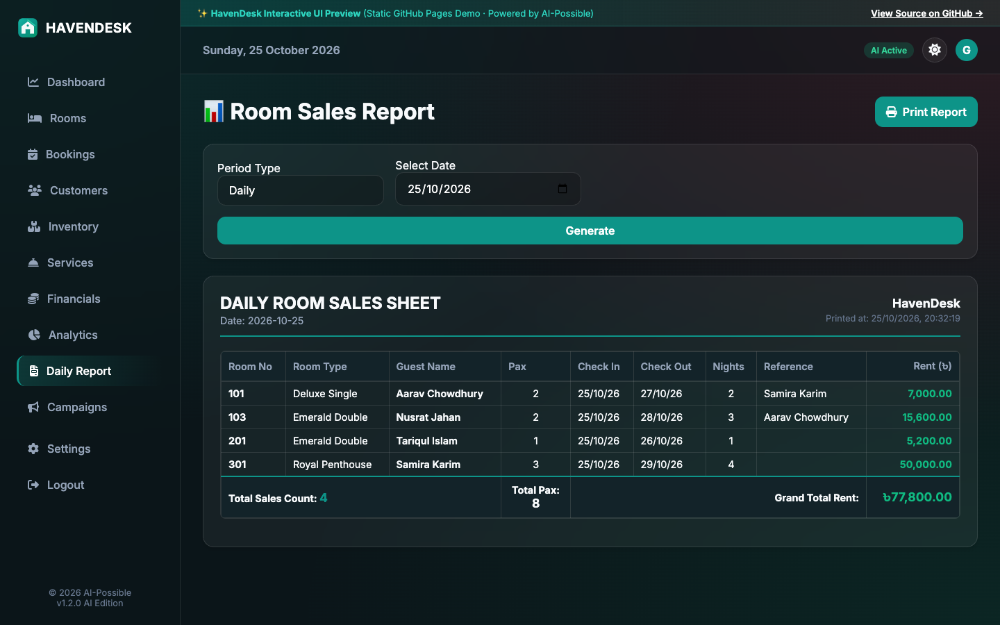
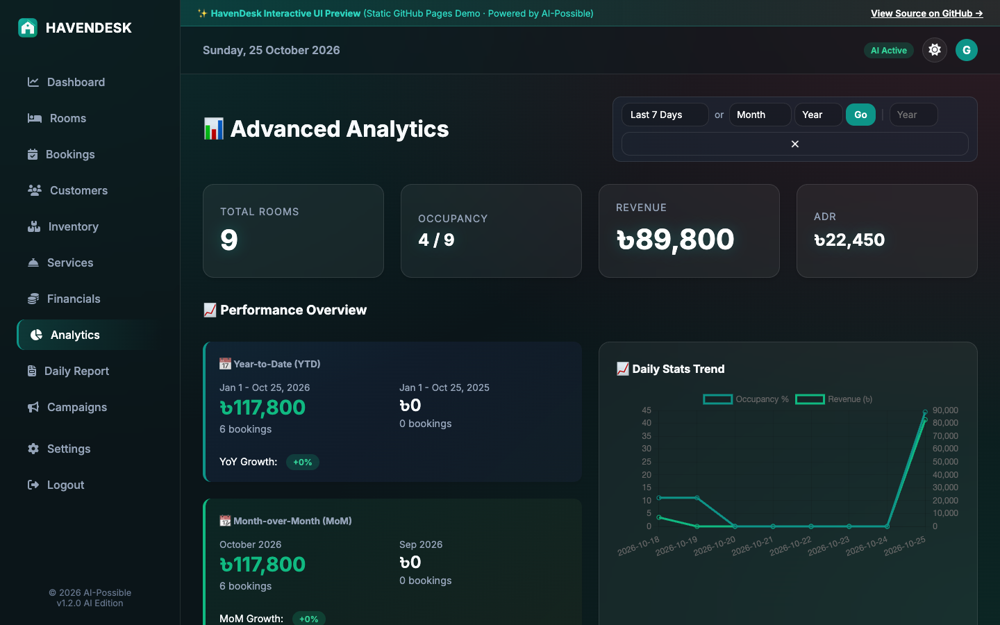

<div align="center">
  
  <h1>HavenDesk</h1>
  <p><strong>A Calm, All-in-One Hotel Operations, CRM & Guest Marketing Platform</strong></p>
  <p>Built with <b>FastAPI</b> · <b>SQLite</b> · <b>Jinja2</b> · <b>AI-Possible Hospitality Suite</b></p>
  <p>
    <a href="https://fahim043.github.io/havendesk/"><strong>🌐 Live Interactive UI Preview (GitHub Pages) →</strong></a>
  </p>
</div>

---

## ✨ Overview

**HavenDesk** is a full-featured hospitality management system designed for boutique and mid-sized hotels. It unifies front-desk check-in/out workflows, multi-room group reservations, CRM reference tracking, automated room sales sheets, financial accounting, inventory control, AI operational insights, and a built-in **Mail-Merge Guest Campaign Engine** (Email & WhatsApp) in a single glassmorphic interface with both **Dark** and **Light** themes.

---

## 📸 Screenshots

### 1. Executive Dashboard & AI Insights


### 2. Front-Desk Bookings & Group Reservations


### 3. Mail-Merge Guest Campaigns (Email + WhatsApp)


### 4. Check-In Based Room Sales Sheet (Daily / Weekly / Monthly / Custom)


### 5. Business Intelligence & Occupancy Analytics


---

## 🚀 Key Features

| Module | Capabilities |
| :--- | :--- |
| **🛏️ Front-Desk & Bookings** | Instant walk-in check-in, advance reservations, whole-hotel booking mode, mid-stay room upgrades/transfers, stay extensions, late checkout handling, and itemized invoicing. |
| **👥 Group Bookings** | Multi-room check-in under a single group label, per-room stay/service overrides, consolidated master invoices, per-room & per-day invoice breakdowns, and bulk check-in/out. |
| **🔍 CRM & Reference System** | Reuses the guest database for booking references with live AJAX lookup (Name / Phone / NID), inline quick-add, and dual-layer self-reference prevention. |
| **📣 Guest Campaigns** | Rule-based audience builder (visit dates, spend, stays, services used, room types, referrals), manual recipient curation, `{merge_field}` personalisation, generic SMTP email sender, and WhatsApp Click-to-Send + Meta Cloud API support. |
| **📊 Room Sales Reports** | Check-in based Daily, Weekly, Monthly, and Custom range room sales sheets with sticky web scrolling and landscape print layouts with manager signature blocks. |
| **🛎️ Services & Inventory** | Ancillary service catalog, mid-stay charge attachments, stock level tracking, low-stock alerts, and usage logs. |
| **💰 Financials & AI** | Income/expense ledger, payment method breakdowns (Cash, Card, bKash, Nagad, Bank), and AI-driven occupancy/revenue insights. |

---

## 🛠️ Quick Start (Local Setup)

```bash
# 1. Clone the repository
git clone https://github.com/Fahim043/havendesk.git
cd havendesk

# 2. Create & activate a virtual environment
python3 -m venv venv
source venv/bin/activate

# 3. Install dependencies
pip install -r requirements.txt

# 4. (Optional) Re-seed the clean demo database
python3 seed_demo.py

# 5. Start the development server
uvicorn main:app --reload
```

Open **http://127.0.0.1:8000** in your browser:
- **Username:** `admin`
- **Password:** `admin123`

---

## 🌐 Interactive Static UI Preview (GitHub Pages)

The `docs/` folder contains a pre-rendered interactive preview of all 12 screens with embedded API mocks so you can browse the full UI directly on GitHub Pages without running a Python server:
- Enable via **Repository Settings → Pages → Source: Deploy from a branch → Branch: `main` / `/docs`**.

---

## 📜 License & Commercial Use Policy

**Copyright © 2026 Fahim Afridi (AI-Possible). All Rights Reserved.**

This project is released under the **[HavenDesk Non-Commercial & Proprietary Source-Available License](LICENSE)**:

- ✅ **Allowed (Free):** Personal study, academic research, and local evaluation/testing.
- 🚫 **Strictly Prohibited Without Payment:** Using, deploying, hosting (SaaS), modifying, or reselling this software for any hotel, resort, guesthouse, or commercial business operation without a paid **Commercial License**.

💼 **Want to use HavenDesk commercially or deploy it for your property?**  
Please contact **[Fahim Afridi (@Fahim043)](https://github.com/Fahim043)** to purchase a commercial or white-label license.

---

<p align="center">Crafted by <strong>AI-Possible</strong> · <a href="LICENSE">Proprietary / Non-Commercial License</a></p>
